# web-imessage

Read and reply to iMessages / texts from any browser (Windows PC, phone, tablet) using this Mac as the bridge.
Works like Google Messages for web: conversation list, live updates, photos, voice messages, reactions, search, new chats, and phone calls.

No dependencies: it runs on the built-in `python3`.

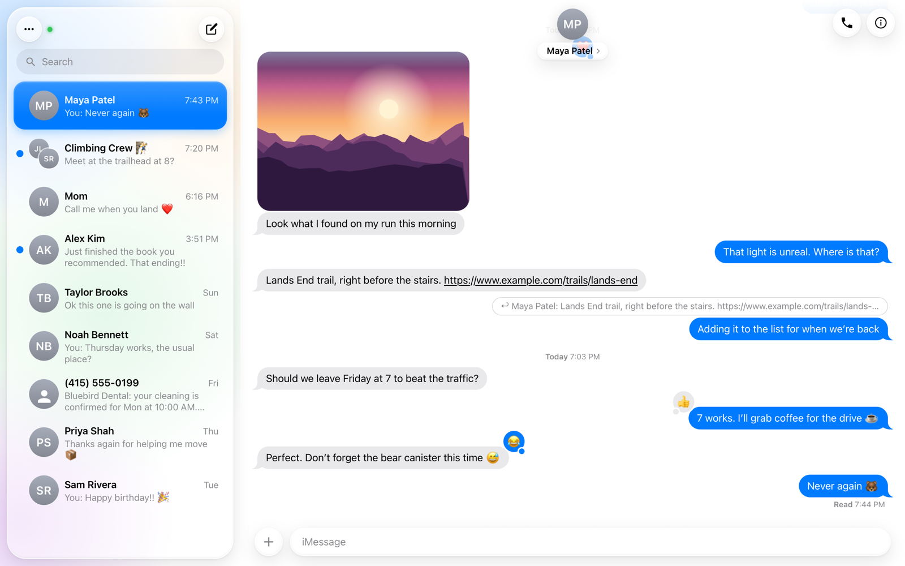

## Start it

```bash
./start.sh
```

It prints the addresses and the password:

```
web-imessage is running
   http://localhost:8642
   http://192.168.1.20:8642
Password: xxxxxxxxxxxx
```

On the Windows PC, open `http://<mac-ip>:8642` and sign in. Sessions last 30 days.
`start.sh` also keeps the Mac and its display from idle-sleeping while the server runs: incoming calls are read from
the call banner on screen, which a sleeping or locked display doesn't show.

## One-time permissions on the Mac

The screenshots show **Visual Studio Code** because that's where the server was started; turn on whichever app runs
`./start.sh` (Terminal, iTerm, VS Code, …).

1. **Full Disk Access** (needed to read the Messages database):
   System Settings → Privacy & Security → Full Disk Access → turn on the app you start the server from
   (**Terminal**, or **Visual Studio Code** if you use its terminal). Quit and reopen that app afterwards.

   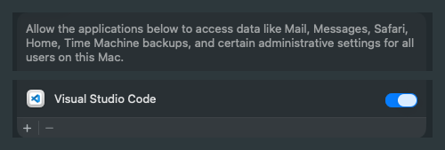
2. **Automation** (needed to send): the first time you send from the browser, macOS asks on the Mac whether
   Terminal/VS Code may control **Messages**. Click **OK**. Do your first send while you're at the Mac.
   If you missed the prompt, turn it on in System Settings → Privacy & Security → Automation:

   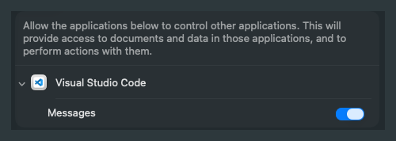
3. If the macOS firewall is on, allow incoming connections for `python3` when prompted.

Messages.app must be signed in, and it is launched automatically when sending.
SMS/green-bubble sending needs *Text Message Forwarding* enabled for this Mac on your iPhone.

## Features

- Conversation list with contact names and photos (from Contacts), unread badges, snippets
- iMessage + SMS threads with the same person are merged into one conversation
- Live updates (Server-Sent Events) with optional sound; unread count in the tab title
- Text, emoji, links, replies (shown as quotes), edited / unsent markers, group events
- Tapback reactions, including custom emoji reactions
- Photos (HEIC is converted to JPEG on the fly), stickers, video, voice messages (CAF → M4A), file downloads
- Send text and attachments (button, drag-and-drop, or paste an image)
- Start new conversations by contact name, phone number, or email
- Contact details panel (click the name at the top of a conversation): all numbers/emails with labels, birthday, address, notes,
  call/mail shortcuts, and the photos, links, and documents you've shared. Group chats list members; click one for their card.
- Full-text search across all messages, then jump to the result in context
- iMessage-style design with a Liquid Glass look; light/dark theme, draft saving per conversation, keyboard shortcuts (Enter to send, Shift+Enter for newline, Ctrl+K to search)
- Phone layout: single-pane with back navigation; can be added to the home screen

## Screenshots

All names, numbers, messages and photos in these screenshots are made up.

| | |
|---|---|
| 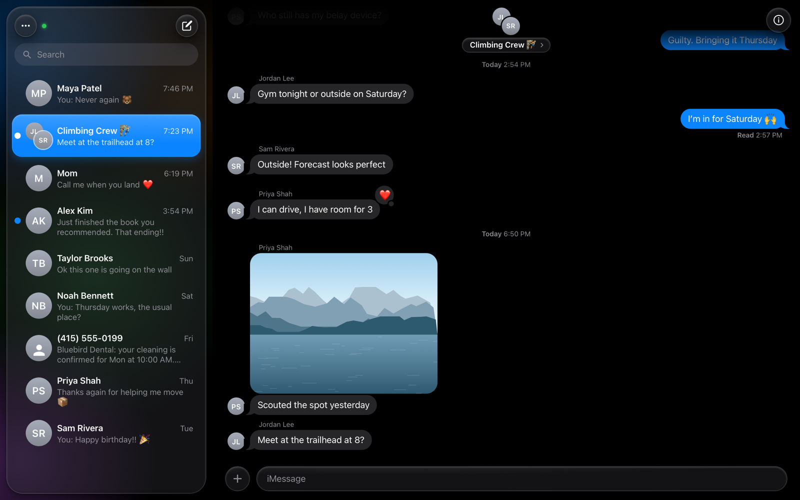 | 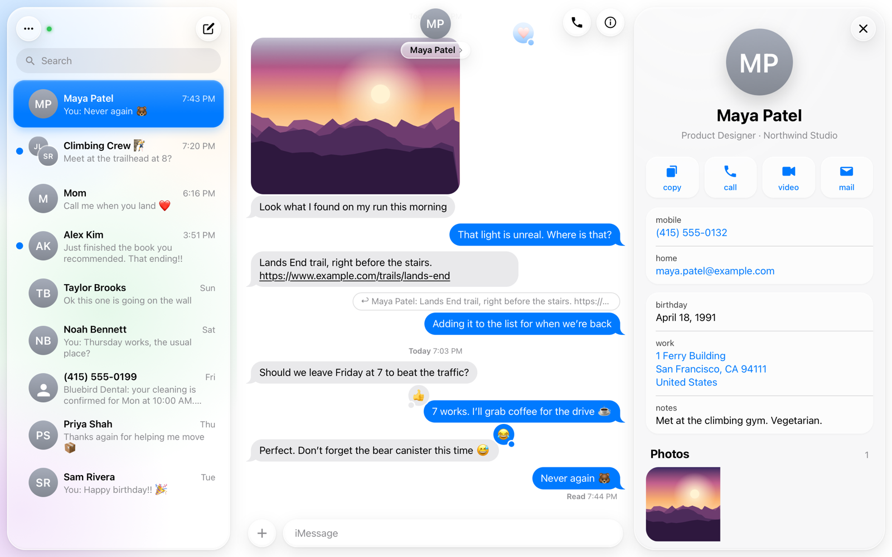 |
| Group chat, dark theme | Contact details and shared photos |
| 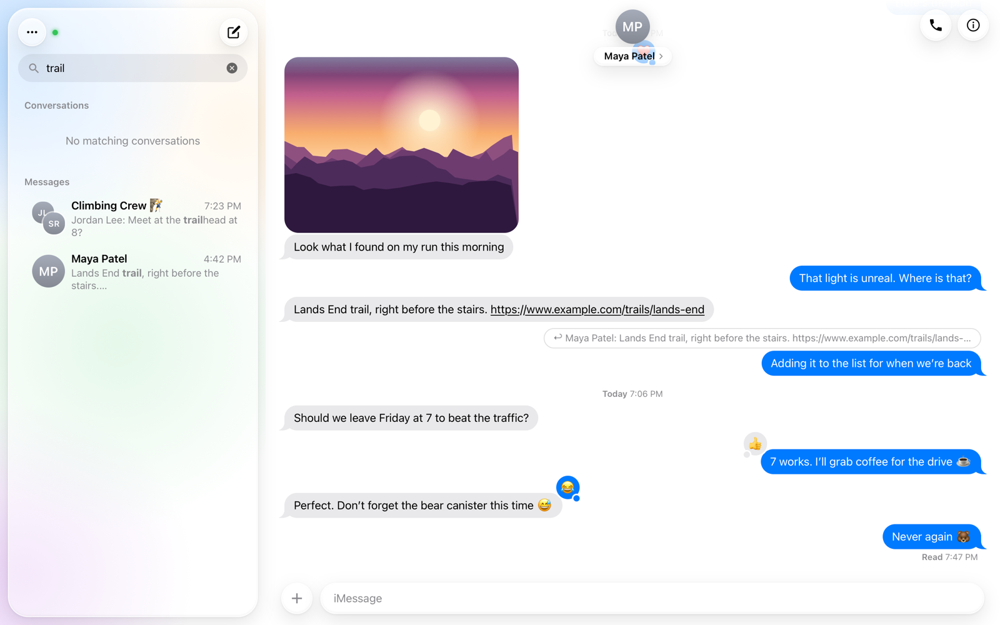 | 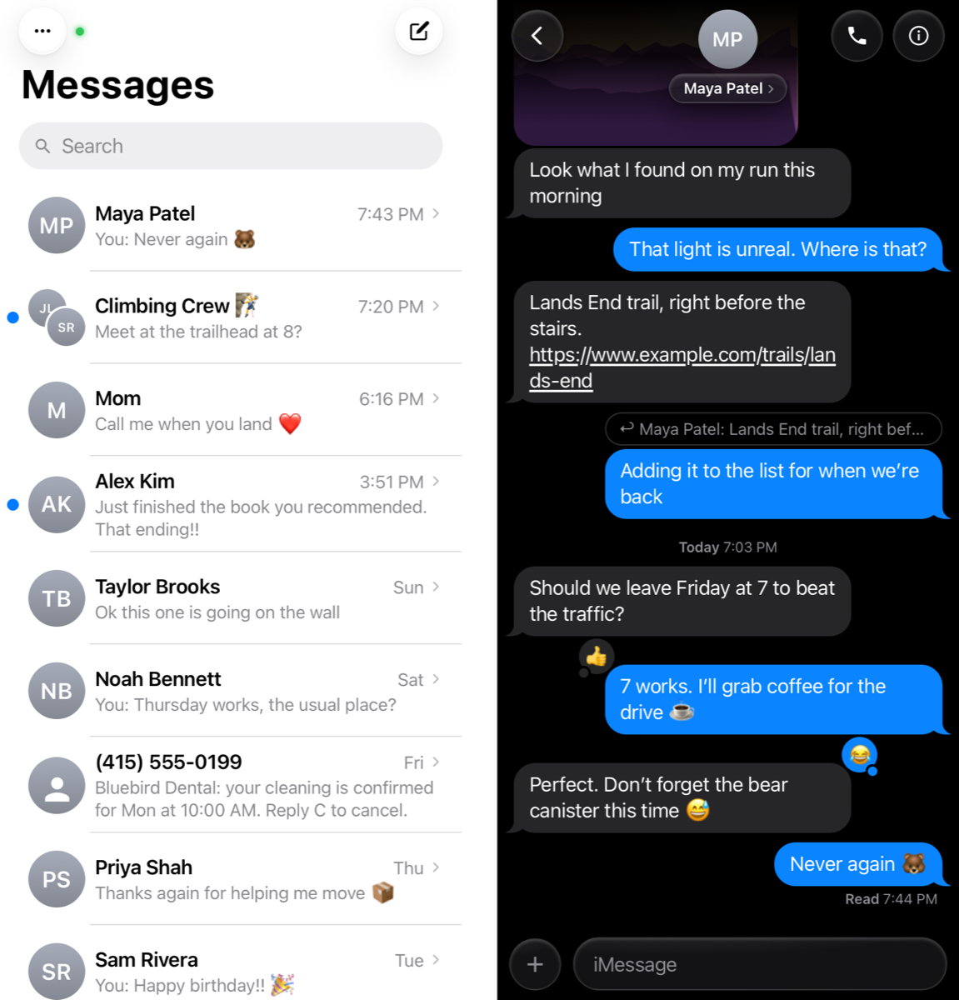 |
| Search across all messages | Phone layout |

## Calls (phone and FaceTime through the Mac)

Calls are placed and answered by the Mac (phone calls go through your iPhone, as with Continuity); their sound streams to
the browser and your microphone streams back. FaceTime video calls also show the FaceTime window's video.

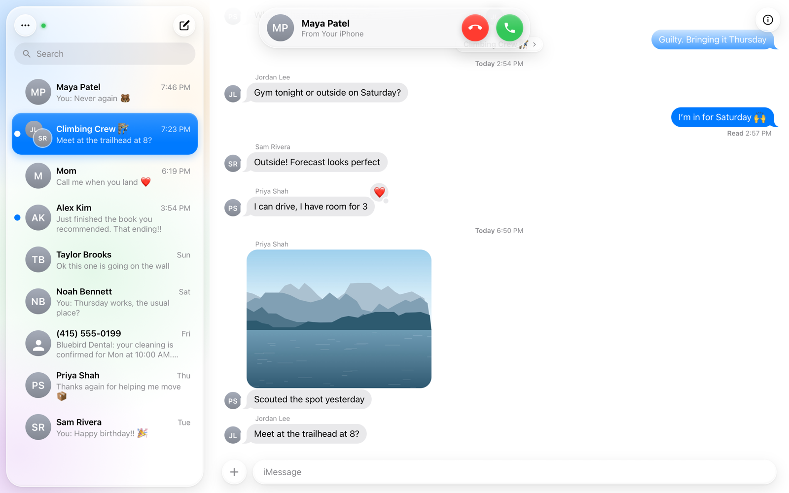

One-time setup:

1. **Virtual audio devices** on the Mac (asks for the Mac's password):
   ```bash
   brew install --cask blackhole-2ch blackhole-16ch
   ```
   During a call the server temporarily makes *BlackHole 2ch* the Mac's output and *BlackHole 16ch* its input, and
   puts your normal devices back when the call ends.
2. **Accessibility** (to see, answer, decline and end calls): System Settings → Privacy & Security → Accessibility →
   turn on Terminal (the app that runs `./start.sh`).

   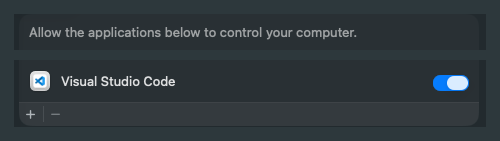
3. **Screen & System Audio Recording**: same place, turn on Terminal. Since macOS 26, call banners (incoming calls,
   the "Click to Call" prompt) are invisible to Accessibility, so the server reads them from the screen and clicks
   their buttons. Also needed for FaceTime video.

   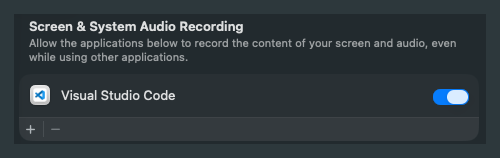
4. **Use https**: browsers only allow the microphone on secure pages. Open `https://<mac>:8643`. To avoid the certificate
   warning on Windows, download `http://<mac>:8642/ca.crt`, open it → Install Certificate → Current User →
   "Place all certificates in the following store" → Trusted Root Certification Authorities, then restart the browser.
   (The certificate is created on your Mac and only vouches for this server.)
5. **Phone calls**: on the iPhone, Settings → Apps → Phone → Calls on Other Devices → turn on the Mac.

Start a call from the phone button at the top of a conversation or from a contact's details. Incoming calls show a
banner with Accept / Decline. Use headphones if your PC speakers echo into the microphone.

If the Mac itself doesn't ring until the iPhone's voicemail picks up, macOS is silencing the call: it does that while
the screen is shared (Screen Sharing) unless System Settings → Notifications → **when mirroring or sharing the display**
is set to **Allow Notifications**, and Focus modes can do the same. Calls the iPhone has already handed to Live Voicemail
drop when answered on the Mac, so the Mac has to ring normally.

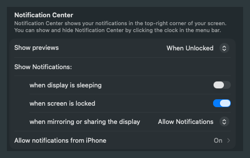

If incoming calls aren't detected, open `https://<mac>:8643/api/call/debug` while a call is ringing; it lists what
the server can see of the Mac's call window, which helps adjust the detection.

## Limitations (macOS restrictions)

- **Sending reactions, editing, and unsending** aren't possible; Apple doesn't expose them to scripts.
- **Read receipts**: reading on the web doesn't mark messages read in Messages.app. The web app tracks what you've read on its own.
- **New group chats** can't be created from the web (replying in existing groups works).
- Attachments that live only in iCloud (not downloaded to this Mac) show as unavailable.
- Desktop notifications require the https address; over plain `http://` you get sound + tab-title badges instead.
- Your camera isn't sent in FaceTime video calls (the Mac mini has no camera to stand in for it); you see the other person, they don't see you.

## Security

- Password-protected; sessions are signed, `HttpOnly`, `SameSite=Strict` cookies. Repeated wrong passwords are rate-limited.
- Traffic is plain HTTP, which is fine on your home network. **Don't port-forward this to the internet.** For access away from home,
  use a private network such as Tailscale, then open `http://<mac-tailscale-name>:8642`.
- Change the password (signs out every browser): `python3 server.py --set-password`, run in a second terminal. A running server picks it up within a second; no restart needed.
- Config lives in `~/.web-imessage/` (`config.json` has `host`/`port`/`password`). Converted images are cached in `~/Library/Caches/web-imessage/`.
  Files you send are staged in `~/Pictures/web-imessage-uploads/` (Messages can only send from certain folders) and cleaned after 3 days.

## Files

- `server.py`: HTTP server, chat.db reader, Contacts lookup, AppleScript sender, media conversion
- `static/`: the web app (`index.html`, `app.js`, `style.css`)
- `docs/screenshots/`: README images, rendered from made-up data
